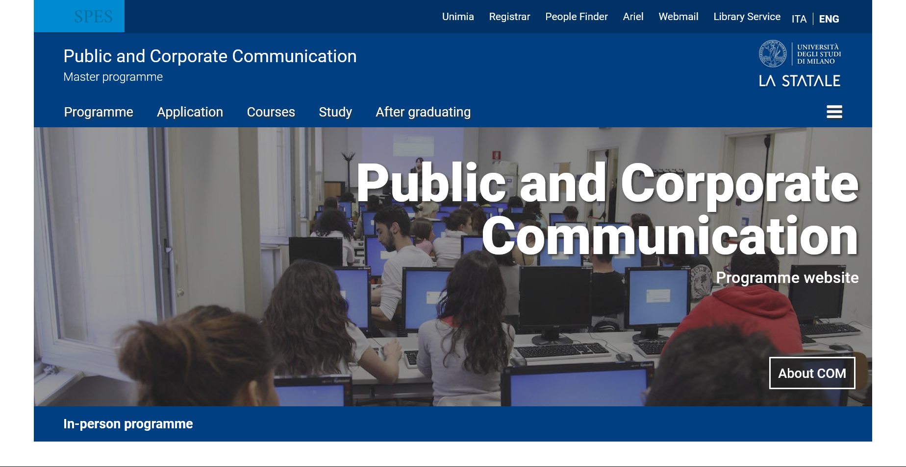

# learn-web-playground-2026-27

Explore web publishing by working on your own version of the in-class doing project: a refactoring of the well-known [cdl.unimi.it/spes/com](https://cdl.unimi.it/spes/com)

Please see folder [learn-web\42-frames](https://github.com/ale66/learn-web/learn-web\42-frames) for details.

---

## Participate to the first in-class lab

## Week 5

Mid-October you should, ideally, be level with the following milestone:

a version of the `30-visuals/exercise-a` folder with

- an own hero page for COM;
- own styles in `mystyle.css` and/or `fonts-style.css`;
- owm images in `./imgs/`;
- links on the page, images embedded;
- YT and GM embeds, e.g., a video about COM and a Google Maps, and
- possibly, own video (upload to new folder `./videos/` or `./av/`).

---

## Week 6

In late October you should, ideally, have completed the following milestone

- be able to pair-code using the VS Code live server extension

- have a GH *student* account

- (via instructor's own folder) on `ale66.github.io/learn-web-playground-2026-27/essays/name.surname/`

- have copy+pasted your own files there

- made floating menu with useful links

- boxed up some official text from `https://com.cdl.unimi.it/en` and made it float in your project page

- make a menu of navigation links and float it (details in past presentations)

---

## Participate to the second in-class lab

## Week 9

Create your own web profile and portfolio!

- On your own GH profile, create a public repository named, strictly, `<your-id>.github.io`, e.g., the instructor has `ale66.github.io`

- in the creation form, select `README.md' and MIT license, then clone the new repository on your computer

- edit `README.md` in Markdown to create your own page and portfolio, follow instructions from `learn-web/86-Markdown/github-pages.html`

- create the `assets` folder, inside it create the `images` and `styles` folders. Add some images and your styles, to be included to `README`.md with a HTML line.

- from your computer, `git status`, `git add`, `git commit -m` and `git push` to publish your page incrementally

## Week 10

Prepare your profile for assessment.

a. In your `github.com/<your-id>` use the menus on the right to:
 
  - put your actual name and a profile picture; 
  
  - add summary information about yourself, e.g. *MA COM, class of 2028* and some links

b. Create a new repo for your exam submission, follow the guidelines in `learn-web/86-Markdown/github-pages.html` to create, e.g., `<your-id>.github.io/my-repo`

c. Now go to your public profile repo, `<your-id>.github.io`, and link, with some description for each:

    - the class repo, `github.com/ale66/learn-web`
    - the class playground, `github.com/ale66/learn-web-playground-2026-27` 
    - your own refactoring project, `github.com/ale66/learn-web-playground-2026-27/essays/<your-id>`

d. Include at least one picture of the *Conservatorio* campus or the surroundings (no recognisable people please please, unless it's you)

e. [discretionary: make the MA COM refactoring a stand-alone repo, e.g., `<your-id>.github.io/ma-com-new`]

