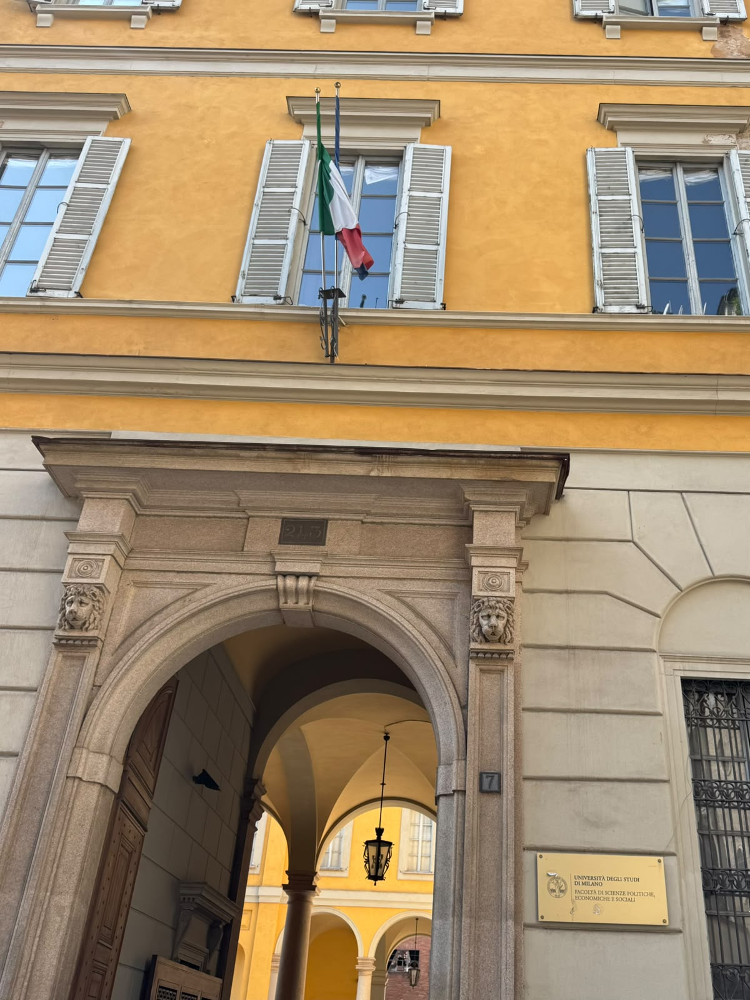

# About the course

The **MA in COM** offers a range of specialisations in public and corporate communications, marketing, advertising and political communications.

## What you can study

- *Corporate communication*
- *Marketing and advertising*
- *Political communication*

## Useful links

[Official website](https://com.cdl.unimi.it/en)

[University of Milan](https://www.unimi.it/en)

### A photo

__A building of the University of Milan__